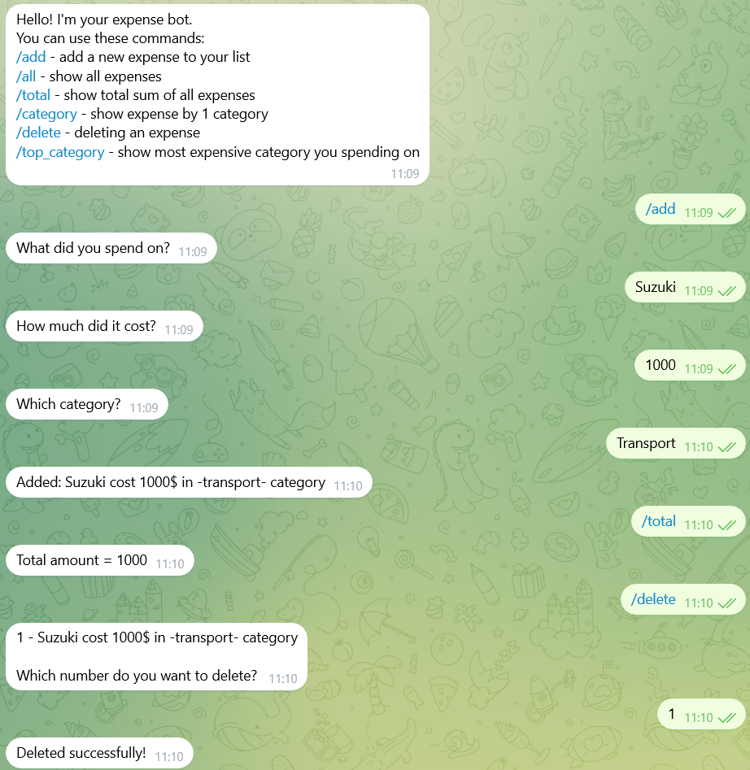
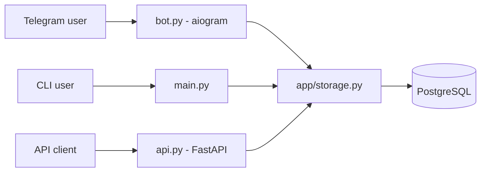

# Python Spending Manager

A personal expense tracker with three interfaces: a command-line tool, a Telegram bot, and a REST API. Data is stored in PostgreSQL and the whole stack runs with Docker Compose.



## Features

- Add expenses with a name, price, and category
- View all expenses and calculate total spending
- Filter expenses by category
- Delete a specific expense
- Multi-user support: every user sees only their own data
- Telegram bot with multi-step dialogs (FSM) for adding and deleting expenses
- REST API built with FastAPI, protected with per-user API keys
- Automated API tests with pytest on a separate test database
- Deployed to a VPS with Docker Compose

## Tech Stack

| Technology | What it is used for |
|---|---|
| Python 3.12 | Main language |
| aiogram | Async Telegram bot framework |
| FastAPI + Pydantic | REST API and request/response validation |
| SQLAlchemy | ORM, database access layer |
| PostgreSQL 16 | Persistent data storage |
| Docker + Docker Compose | Packaging and running the bot, the API and the database |
| python-dotenv | Loading secrets from a `.env` file |
| pytest + FastAPI TestClient | Automated API tests |

## Architecture



All three interfaces share the same data layer (`app/storage.py`), so the business logic is written once.

## Project Structure

```
.
├── app/
│   ├── db.py          # database engine and session setup
│   ├── models.py      # SQLAlchemy models (Expense, Apikey)
│   ├── schemas.py     # Pydantic schemas for the API
│   ├── states.py      # FSM states for bot dialogs
│   └── storage.py     # all database operations
├── scripts/
│   └── migrate.py     # one-off script: import old expenses.txt into PostgreSQL
├── tests/
│   ├── conftest.py    # test database setup and cleanup fixture
│   └── test_api.py    # API tests
├── api.py             # FastAPI application
├── bot.py             # Telegram bot entry point
├── main.py            # CLI entry point
├── Dockerfile
├── docker-compose.yml # bot + API + PostgreSQL
├── requirements.txt
├── requirements-dev.txt # test-only dependencies
├── pytest.ini         # pytest settings
└── .env.example       # template for environment variables
```

## Quick Start (Docker)

```bash
git clone https://github.com/ruslan-chornyi/python-spending-manager.git
cd python-spending-manager
cp .env.example .env      # on Windows: copy .env.example .env
# edit .env and put your bot token (see below)
docker compose up --build
```

This starts PostgreSQL, the Telegram bot and the REST API. The API creates any missing database tables when it starts. The database data is kept in a Docker volume, so it survives restarts and rebuilds.

All ports are published on `127.0.0.1` only, so the database and the API are not reachable from the internet.

### Environment variables

| Variable | Description |
|---|---|
| `BOT_TOKEN` | Telegram bot token from [@BotFather](https://t.me/BotFather) |
| `POSTGRES_PASSWORD` | Password for the PostgreSQL user (used when the database is created for the first time) |
| `DATABASE_URL` | PostgreSQL connection string, see `.env.example` for the format. It must use the same password |

Do not put spaces around `=` in the `.env` file: Docker is stricter about this than python-dotenv.

## Bot Commands

| Command | What it does |
|---|---|
| `/add` | Add an expense (asks for name, price, and category step by step) |
| `/all` | Show all your expenses |
| `/total` | Show your total spending |
| `/category` | Filter expenses by category |
| `/delete` | Delete an expense from a numbered list |
| `/top_category` | Show the category you spend the most on |
| `/apikey` | Get a personal key for the REST API (replaces your previous key) |

## REST API

The API is started by Docker Compose together with the bot. To run it on your machine without Docker (the database must be running, for example `docker compose up db`, and `DATABASE_URL` must use `localhost` instead of `db`):

```bash
pip install -r requirements.txt
uvicorn api:app --reload
```

Interactive documentation is available at `http://127.0.0.1:8000/docs`.

### Authentication

Every `/expenses` request needs an `X-API-Key` header. To get a key, send `/apikey` to the Telegram bot. The key is linked to your Telegram account, so the API shows the same expenses as the bot.

The database stores only a SHA-256 hash of each key, never the key itself, so the bot can show a key only once. Running `/apikey` again creates a new key and turns off the old one.

```bash
curl -H "X-API-Key: YOUR_KEY" http://127.0.0.1:8000/expenses
```

### Endpoints

| Method | Endpoint | Description |
|---|---|---|
| GET | `/health` | Health check, no key needed |
| GET | `/expenses` | List your expenses |
| POST | `/expenses` | Create an expense, body: `{"name": "Coffee", "price": 5, "category": "drink"}` (returns 201) |
| DELETE | `/expenses/{expense_id}` | Delete one of your expenses (returns 204) |

| Status | When |
|---|---|
| 401 | The API key is wrong |
| 404 | The expense does not exist or belongs to another user |
| 422 | The `X-API-Key` header is missing or the request body is invalid |

## Tests

The tests use FastAPI's `TestClient` and a separate SQLite database (`test.db`), so they never touch real data. A fixture recreates the tables before every test, so each test starts from an empty database.

```bash
pip install -r requirements-dev.txt
pytest
```

## Deployment

The bot, the API and PostgreSQL run on a small VPS (DigitalOcean) with Docker Compose. The API is not exposed to the internet yet. It listens on `127.0.0.1` and I reach it through an SSH tunnel:

```bash
ssh -L 8001:127.0.0.1:8000 user@server
```

Then the docs are available at `http://127.0.0.1:8001/docs`.

## CLI Version

With the database running, you can also use the command-line interface:

```bash
python main.py
```

## What I Learned

Building this project, I practiced OOP, async programming, working with a relational database through an ORM, containerizing an application with Docker, and deploying it to a VPS. With the REST API I learned dependency injection in FastAPI, API key authentication with hashed keys, application startup with `lifespan`, and testing with pytest, dependency overrides and fixtures.

## Roadmap

- HTTPS with a reverse proxy, so the API can be opened to the internet
- Database migrations with Alembic
- Inline keyboard buttons in the bot instead of text commands
- CI/CD pipeline that runs the tests on every push