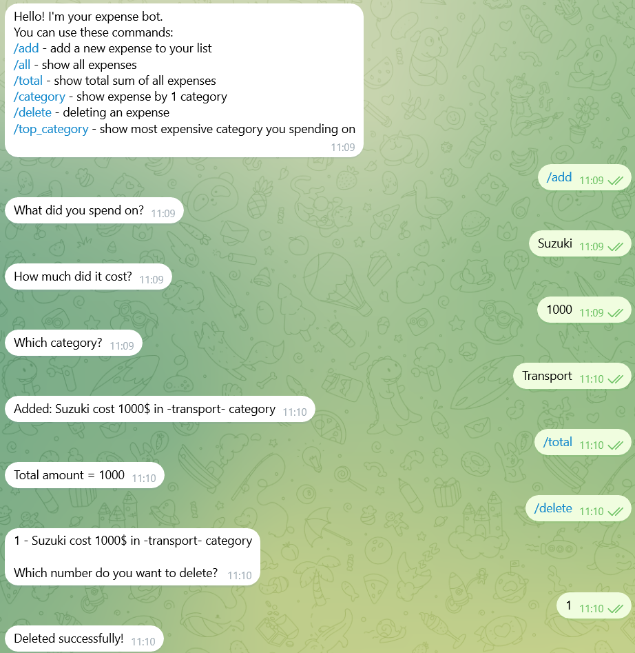
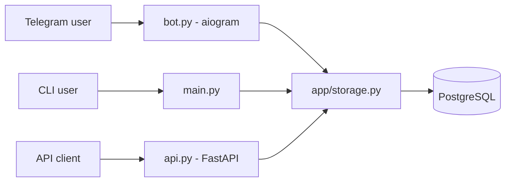

# Python Spending Manager

A personal expense tracker with three interfaces: a command-line tool, a Telegram bot, and a REST API. Data is stored in PostgreSQL and the whole stack runs with Docker Compose.



## Features

- Add expenses with a name, price, and category
- View all expenses and calculate total spending
- Filter expenses by category
- Delete a specific expense
- Multi-user support: every user sees only their own data
- Telegram bot with multi-step dialogs (FSM) for adding and deleting expenses
- REST API built with FastAPI (in progress)

## Tech Stack

| Technology | What it is used for |
|---|---|
| Python 3.13 | Main language |
| aiogram | Async Telegram bot framework |
| FastAPI + Pydantic | REST API and request/response validation |
| SQLAlchemy | ORM, database access layer |
| PostgreSQL 16 | Persistent data storage |
| Docker + Docker Compose | Packaging and running the bot and the database |
| python-dotenv | Loading secrets from a `.env` file |

## Architecture



All three interfaces share the same data layer (`app/storage.py`), so the business logic is written once.

## Project Structure

```
.
├── app/
│   ├── db.py          # database engine and session setup
│   ├── models.py      # SQLAlchemy models (Expense)
│   ├── schemas.py     # Pydantic schemas for the API
│   ├── states.py      # FSM states for bot dialogs
│   └── storage.py     # all database operations
├── scripts/
│   └── migrate.py     # one-off script: import old expenses.txt into PostgreSQL
├── api.py             # FastAPI application
├── bot.py             # Telegram bot entry point
├── main.py            # CLI entry point
├── Dockerfile
├── docker-compose.yml # bot + PostgreSQL
├── requirements.txt
└── .env.example       # template for environment variables
```

## Quick Start (Docker)

```bash
git clone https://github.com/ruslan-chornyi/python-spending-manager.git
cd python-spending-manager
cp .env.example .env      # on Windows: copy .env.example .env
# edit .env and put your bot token (see below)
docker compose up --build
```

This starts PostgreSQL and the Telegram bot. The database data is kept in a Docker volume, so it survives restarts.

### Environment variables

| Variable | Description |
|---|---|
| `BOT_TOKEN` | Telegram bot token from [@BotFather](https://t.me/BotFather) |
| `DATABASE_URL` | PostgreSQL connection string, see `.env.example` for the format |

Do not put spaces around `=` in the `.env` file: Docker is stricter about this than python-dotenv.

## Bot Commands

| Command | What it does |
|---|---|
| `/add` | Add an expense (asks for name, price, and category step by step) |
| `/all` | Show all your expenses |
| `/total` | Show your total spending |
| `/category` | Filter expenses by category |
| `/delete` | Delete an expense from a numbered list |

## REST API (in progress)

Run locally (the database must be running, for example `docker compose up db`):

```bash
pip install -r requirements.txt
uvicorn api:app --reload
```

Interactive documentation is available at `http://127.0.0.1:8000/docs`.

| Method | Endpoint | Description |
|---|---|---|
| GET | `/expenses?user_id=` | List expenses of a user |
| POST | `/expenses` | Create an expense (returns 201) |
| DELETE | `/expenses/{id}?user_id=` | Delete an expense (204, or 404 if not found) |

## CLI Version

With the database running, you can also use the command-line interface:

```bash
python main.py
```

## What I Learned

Building this project, I practiced OOP, async programming, working with a relational database through an ORM, containerizing an application with Docker, and deploying it to a VPS.

## Roadmap

- Unit tests with pytest
- Inline keyboard buttons in the bot instead of text commands
- FastAPI service in Docker Compose
- CI/CD pipeline